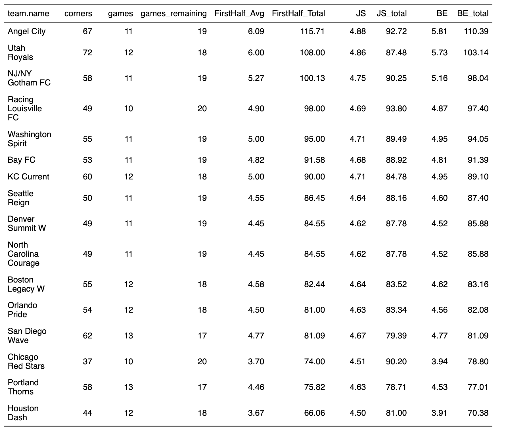

### Background

I haven't posted on my blog in a while, but I had a few things line up that justify this article. So I hope someone somewhere finds this interesting and/or useful. I have been taught better than to start a presentation or discussion with a disclaimer, but I want to start by prefacing this article with a reminder that this blog at large serves as a creative outlet and way for me to practice scientific writing and my analyses.

A few weeks ago, I overheard our coaching staff asking to 'estimate the number of corner kicks we will have per game second half of the season' among some other things that they were interested in estimating. This is interesting to me because it lined up right with when I was reading "Stein's Paradox in Statistics" by Efron & Morris (1977) as well as some other articles (namely, Pat Ward's blog posts and the TidyX screencast on the topic. If you're unfamiliar with his blog, I cannot recommend it enough he's unequivocally the goat in this field.) 

Another important piece of context for this article is that I also heard our coach say, "Just take the average of the corners per game so far and multiply it by the number of games we have remaining." This isn't inherently a bad approach; in fact, in Efron & Morris (1977), they start with the quote, "The best guess about the future is usually obtained by taking the average of past events. Stein's paradox defines circumstances in which there are estimators better than the arithmetic average." I thought since I heard this question and learned about Stein's Paradox and the James-Stein Estimator around the same time, I would like to combine them in this post (along with other, suggested ways to predict future performance).

#### Estimating Performance

I operate under the belief that performance is a combination of luck and skill, and that true performance = what we've observed +/- error. In the context of the examples using batting average discussed by Efron & Morris (1977), an athlete who steps up to the plate once may get a hit and have a batting average of 1.00, but we know that he is not actually the best baseball player of all time. His true performance is likely something much lower, but we are left with small sample sizes that undermine our estimate. This problem, along with survivorship bias, is actually very common in sports analytics. Fortunately, however, there are ways for us to address them and improve the accuracy of our forecasts/estimates.

#### More on Efron & Morris (1977)

Efron & Morris (1977) used the batting averages of 18 MLB players that were recorded after the first few months of the season (they use the first 45 at-bats, but we'll align more closely to Pat Ward's example for the sake of this discussion). Basically, when you look at the distribution of batting averages for this sample, there is an obvious right skew of the data; in other words, most athletes have batting averages at or around 0, but there are some at 1 (presumably because they had 1 at-bat and got a hit). If we wanted to estimate their performance through the rest of the season, it would be naive to think that the athletes with a batting average through the first few months of 1.0 would maintain that. Therefore, there are other methods to estimate future performance based on observed data. Specifically, the statistician who employs Stein's method can expect to predict future averages more accurately no matter what the true ability of the player may be.

#### The James-Stein Esimator

Stein's method involves applying a calculated "shrinking" factor of all the individual averages toward the calculated "grand" averages. The resulting shrunken value is the James-Stein estimator, which is calculated with the equation: JS = group_mean + c(obs_value – group_mean), while c is a constant that represents the shrinkage factor. c is calculated as:  

c = 1 – ((k – 3)*σ^2)/(Σ(y – ŷ)^2)

Refer to the full article if you want to read about the baseball example lol because I don't want to type out what they found. It's a great read anyways so it'd be better than this.

Basically, the question becomes, which set of values, obs_value or JS (or the Bayes estimator which I will also investigate in this post), is the better indicator of future performance.

### Soccerrrrr

I will now bring this back to soccer and the question that prompted me to the write this post. I want to estimate how many corner kicks we will have through the rest of the season. I'm not entirely sure, but I think I will replace batting average with literally just corners per game. I probably should use corners per 90 but the benchmark in this analysis will be the number of corners / the number of games so far (which is what the coaches used for the arithmetic-mean based forecase), so I will keep it aligned with that. I also would really like to keep this project open-source, but I'll need to use the StatsBomb's not-open data for this project. 

So let's get to it!

#### Getting Data

First, we need to load the StatsBombR package and we'll also load dplyr and ggplot2 for wrangling and visualization. I will also set my credentials for the StatsBomb data so I get this season's data.

```
library(StatsBombR)
library(dplyr)
library(ggplot2)
library(flextable)
```

The purpose of this analysis is really to be able to forecast how many corners our team will get in the remaining games this season using an approach that is better arithmetic average. However, doing both - evaluating the different approaches and forecasting the rest of the season would be difficult because we don't yet have the data from the remaining games to see which approach performs the best. Therefore, the remainder of this post will involve (1) evaluating arithmetic mean, James-Stein estimator, and Empirical Bayes approaches for forecasting corners per game in the second half of the 2025 NWSL season using data from the first half, and (2) using each approach to forecast the corners per game in the second half of the 2026 NWSL season using data from the games played so far.

To get started, we need to get the competition ids for the 2025 NWSL season and then the match ids so we can retrieve the event (including corner) data. 

##### Load Match Ids
```
competitions <- StatsBombR::competitions(username, password)
NWSL_competitions <- competitions %>% 
  dplyr::filter(competition_name == "NWSL")

matchids_2025 <- StatsBombR::get.matches(
    username,
    password,
    season_id      = 315,
    competition_id = 49
  ) %>% 
  dplyr::filter(collection_status == "Complete")
matchids <- matchids_2025$match_id
str(matchids)
```

##### Load Events and Get Corners per Game by Team
```
events <- allevents(username, password, matches = matchids) %>%
  allclean()
head(events)
```

```
# get corners
corners <- events %>% 
  dplyr::select(match_id, team.name, pass.type.name) %>% 
  dplyr::filter(pass.type.name == "Corner")

# get match date to split into first and second half of the season
matchdetails <- matchids_2025 %>% 
  dplyr::select(match_id, match_date, home_team.home_team_name, away_team.away_team_name)

# merged and summarized so we have the count of corners in each game
corners <- corners %>% 
  merge(matchdetails, by="match_id") %>% 
  dplyr::group_by(match_id, match_date, team.name, home_team.home_team_name, away_team.away_team_name) %>% 
  dplyr::summarize(corners = n())

head(corners)
```

Next, we will build 2 dataframes: 1 for the first half of the season (train) and 1 for the second half of the season (test).

```
### split first and second halves of the 2025 nwsl season
dat_firsthalf <- corners %>% 
  dplyr::filter(match_date < "2025-06-25")
dat_secondhalf <- corners %>% 
  dplyr::filter(match_date > "2025-06-25")

# (this probably isn't a perfect split but it will work)
 
## Explore the data frames
head(dat_firsthalf)
head(dat_secondhalf)
 
dim(dat_firsthalf) # 595 x 29
dim(dat_secondhalf) # 611 x 29
```

Next, I will summarize the data to create a simple dataframe that presents the average number of corners per game in the first and second halves of the season per team.
```
pergame_firsthalf <- dat_firsthalf %>%
  ungroup() %>% 
  group_by(team.name) %>%
  summarise(
    half_corners = sum(corners, na.rm = TRUE),
    half_games = n_distinct(match_id),
    corners_per_game = half_corners/half_games,
    .groups = "drop"
  )
  
pergame_secondhalf <- dat_secondhalf %>%
  ungroup() %>% 
  group_by(team.name) %>%
  summarise(
    half_corners = sum(corners, na.rm = TRUE),
    half_games = n_distinct(match_id),
    corners_per_game = half_corners/half_games,
    .groups = "drop"
  )
```


##### Explore the Data
```
par(mfrow = c(1,2))
hist(pergame_firsthalf$corners_per_game, col = "grey", main = "First Half of the Season")
rug(pergame_firsthalf$corners_per_game, col = "red", lwd = 2)
hist(pergame_secondhalf$corners_per_game, col = "grey", main = "Second Half of the Season")
rug(pergame_secondhalf$corners_per_game, col = "red", lwd = 2)
```

As Pat puts it, forecasting future performance with small sample sizes makes it difficult to have faith in predicting true ability. This is one area in which the James-Stein Estimator and Bayes Estimation approaches may be useful, as they allow for shrinkage of the observed values towards the mean. In this way, the forecast isn’t too overly confident about the team who averaged 6 corners per game and it isn’t too under confident about the team who averaged 3 per game. Additionally, if the samples were even smaller and there was a team that averaged 0 corners per game, the forecast will suggest that the team is average until future data/observations can be gathered to prove otherwise. (this is especially relevant in epidemiological research where, for example, you may be interested in the presence of a disease in a particular community and although you measure the proportion of individuals to be 0, there is still some "shrinkage" of the estimate towards the population mean although in this example the "shrinkage" increases the value.)

#### (Finally Actually) Esimating Performance
Inspired by Efron & Morris (1977) and Pat Ward's blog, we will deploy 3 approaches to forecast performance in the second half of the season:  
1. Use the average corners per game of the team in the first half of the season and assume that the second half would be similar. This will server as our benchmark for which the other two approaches need to improve upon if we are to use them. (Note, however, again that this approach doesn’t help us at all if a team had averaged 0 corners per game). 
2.Use a James-Stein Estimator to forecast the second half of the season by taking the observed corners per game averages and applying a level of shrinkage to account for some regression to the mean. 
3. Account for regression to the mean by using some sort of prior assumption of the corners per game mean and standard deviation of NWSL team. This is a type of Bayes approach to handling the problem and is discussed in the last section of Efron and Moriss’s article.

#### First Half of the Season Average to Forecast Second Half of the Season Average

I'll quickly merge the first and second half of the season's average corners per game into one dataframe so we can subtract one from the other to obtain the difference in our forecast had we simply assumed the first half of the season's performance (corners_per_game.x) would be similar to the second (corners_per_game.y). Once I have the difference added per team, I'll add columns for the mean absolute error (MAE) and the root mean square error (RMSE), which we will use to compare the other two methods. 

```
pergame <- merge(pergame_firsthalf, pergame_secondhalf, by = "team.name")
pergame <- pergame %>% dplyr::select(team.name, corners_per_game.x, corners_per_game.y)

## Difference between first 30 day BA and second 30 day BA
pergame$Proj_Diff_Avg <- with(pergame, corners_per_game.x - corners_per_game.y)
mae <- mean(abs(pergame$Proj_Diff_Avg), na.rm = T)
rmse <- sqrt(mean(pergame$Proj_Diff_Avg^2, na.rm = T))
```

#### Using the James-Stein Estimator

The formula for the James-Stein Estimator is as follows:
\[
JS = \text{group\_mean} + C(\text{obs\_BA} - \text{group\_mean})
\]

Where:

- **group_mean** = the average of all players in the first 30 days
- **obs_BA** = the observed batting average for an individual player in the first 30 days
- **C** = a constant that represents the *shrinkage factor*. \(C\) is calculated as:

  \[
  C = 1 - \frac{(k - 3)\sigma^2}{\sum (y - \hat{y})^2}
  \]

Where:

  - **k** = the number of unknown means we are trying to forecast (in this case, the sample size of our first 30 days)
  - **\(\sigma^2\)** = the group variance observed during the first 30 days
  - **\(\sum (y - \hat{y})^2\)** = the sum of the squared differences between each player's observed batting average and the group average during the first 30 days

First we will calculate the mean and SD across all teams and squared differences from the first 30 day sample.

```
# Calculate grand mean and sd
group_mean <- round(mean(pergame$corners_per_game.x, na.rm = TRUE), 3)
group_mean # 4.656
 
group_sd <- round(sd(pergame$corners_per_game.x, na.rm = TRUE), 3)
group_sd # 1.084
 
## Calculate sum of squared differences from the group average
sq.diff <- sum((pergame$corners_per_game.x - group_mean)^2)
sq.diff # 15.277
```

Now we calculate the shrinkage factor, *c*

```
k <- nrow(pergame)
c <- 1 - ((k - 3) * group_sd^2) / sq.diff
c # .1539
```

Now we have what we need to make a forecast of the number of corners per game each team will have through the second half of the season using the James-Stein Estimator and calculate the MAE and RMSE

```
pergame$JS <- group_mean + c*(pergame$corners_per_game.x - group_mean)
pergame$Proj_Diff_JS <- with(pergame, JS - corners_per_game.y)

mae_JS <- mean(abs(pergame$Proj_Diff_JS), na.rm = T)
rmse_JS <- sqrt(mean(pergame$Proj_Diff_JS^2, na.rm = T))
```

#### Using a Prior Assumption for Average Corners per Game

Okay so at the end of the Efron & Morris (1977) article, they discuss other approaches in addition to the James-Stein estimator that are known to better than sample averages. We'll explore one of those approaches here with the Bayesian approach.

In this example, the prior for average corner per game I’m going to use will be the mean and standard deviation across all teams from the first half of the season and the past 3 (2022 - 2024) seasons of data.

```
#### get previous 3 seasons of data to build the prior
## get matchids
matchids_2024 <- StatsBombR::get.matches(
    username,
    password,
    season_id      = 282,
    competition_id = 49
    # competition_id = 44
  ) %>% 
  dplyr::filter(collection_status == "Complete")
matchids_2024_ids <- matchids_2024$match_id

matchids_2023 <- StatsBombR::get.matches(
    username,
    password,
    season_id      = 107,
    competition_id = 49
    # competition_id = 44
  ) %>% 
  dplyr::filter(collection_status == "Complete")
matchids_2023_ids <- matchids_2023$match_id

matchids_2022 <- StatsBombR::get.matches(
    username,
    password,
    season_id      = 106,
    competition_id = 49
    # competition_id = 44
  ) %>% 
  dplyr::filter(collection_status == "Complete")
matchids_2022_ids <- matchids_2022$match_id

## get updated events for those ids
matchdetails <- dplyr::bind_rows(matchids_2022, matchids_2023, matchids_2024)
matchids <- c(matchids_2022_ids, matchids_2023_ids, matchids_2024_ids)
events <- allevents(username, password, matches = matchids) %>%
  allclean()

## get corners
corners <- events %>% 
  dplyr::select(match_id, team.name, pass.type.name) %>% 
  dplyr::filter(pass.type.name == "Corner")

# get match date to split into first and second half of the season
matchdetails <- matchdetails %>% 
  dplyr::select(match_id, match_date, home_team.home_team_name, away_team.away_team_name)

# merged and summarized so we have the count of corners in each game
corners <- corners %>% 
  merge(matchdetails, by="match_id") %>% 
  dplyr::group_by(match_id, match_date, team.name, home_team.home_team_name, away_team.away_team_name) %>% 
  dplyr::summarize(corners = n()) %>% 
  ungroup() %>% 
  group_by(team.name) %>%
  summarise(
    corners = sum(corners, na.rm = TRUE),
    games = n_distinct(match_id),
    corners_per_game = corners/games,
    .groups = "drop"
  )
```

```
## create an updated prior using the first half of 2025 and previous 3 season
# first half of 2025
firsthalf2025_avg <- mean(pergame$corners_per_game.x, na.rm = TRUE)
firsthalf2025_sd <- sd(pergame$corners_per_game.x, na.rm = TRUE)

# previous 3 seasons
previous3season_avg <- mean(corners$corners_per_game, na.rm = TRUE)
previous3season_sd <- sd(corners$corners_per_game, na.rm = TRUE)

# prior
prior_cornerspergame_avg <- mean(c(firsthalf2025_avg, previous3season_avg))
prior_cornerspergame_avg
prior_cornerspergame_sd <- mean(c(firsthalf2025_sd, previous3season_sd))
prior_cornerspergame_sd
```

I'll replicate the approach Pat took to calculate the Bayes estimator:

(Bayes Estimator) BE = prior_cornerspergame_avg + prior_cornerspergame_sd(obs_cornerspergame – prior_cornerspergame_avg)

```
pergame$BE <- prior_cornerspergame_avg + prior_cornerspergame_sd*(pergame$corners_per_game.x - prior_cornerspergame_avg)

pergame$Proj_Diff_BE <- with(pergame, BE - corners_per_game.y)
mae_BE <- mean(abs(pergame$Proj_Diff_BE), na.rm = TRUE)
mae_BE
rmse_BE <- sqrt(mean(pergame$Proj_Diff_BE^2, na.rm = TRUE))
rmse_BE
```

### Evaluating our Forecasts

Now I'll put the MAE and RMSE of the 3 approaches into a data frame so we can see how they performed.

```
Comparisons <- c("FirstHalf_Avg", "James_Stein", "Bayes")
mae_grp <- c(mae, mae_JS, mae_BE)
rmse_grp <- c(rmse, rmse_JS, rmse_BE)
 
model_comps <- data.frame(Comparisons, MAE = mae_grp, RMSE = rmse_grp)
model_comps[order(model_comps$RMSE), ]
```

Somewhat unexpectedly, the lowest RMSE is the Bayes Estimator followed by the James-Stein estimator. Both approaches out performed just using the average of the first half of the season as a naive forecast for future performance.

I'll replicate Pat's graph that visualizes the differences in our projections for the three approaches as well.

### Conclusions / Practical Applications

The purpose of this post was largely to give me an excuse to try to apply what I read in the paper by Efron & Morris (1977) about Stein's Paradox. I aimed to work through the approaches to forecasting performance used in that paper by applying it to a question I had recently heard in our environment. 

Dealing with small samples is a problem in sport and what we saw was that if we naively just use the average performance of a team during those small number of observations we may be missing the boat on their underlying true potential due to regression to the mean and the inherent variability/randomness in sport. As such, things like the James-Stein Estimator or Bayes Estimator can help us obtain better estimates by using a prior assumption about the average team in the population.

The question, "how many corners per game do we expect to get through the second half of the season" was asked based on the first 11 games of the 2026 NWSL projecting out through the next 19. With that, I will use each of the following approaches, the arithmetic mean, James-Stein estimator, and Bayes Estimator, to forecase corners per game for the second half of the 2026 NWSL season. And in 3 months time, we can come back and see which approach performed the best.

```
#### get 2026 season data
## get matchids
matchids_2026 <- StatsBombR::get.matches(
    username,
    password,
    season_id      = 316,
    competition_id = 49
  ) %>% 
  dplyr::filter(collection_status == "Complete")
matchids_2026_ids <- matchids_2026$match_id

## get updated events for those ids
matchdetails <- matchids_2026
events <- allevents(username, password, matches = matchids_2026_ids) %>%
  allclean()

## get corners
corners <- events %>% 
  dplyr::select(match_id, team.name, pass.type.name) %>% 
  dplyr::filter(pass.type.name == "Corner")

# get match date to split into first and second half of the season
matchdetails <- matchdetails %>% 
  dplyr::select(match_id, match_date, home_team.home_team_name, away_team.away_team_name)

# merged and summarized so we have the count of corners in each game
corners <- corners %>% 
  merge(matchdetails, by="match_id") %>% 
  dplyr::filter(match_date < "2026-06-10") %>% 
  dplyr::group_by(match_id, match_date, team.name, home_team.home_team_name, away_team.away_team_name) %>% 
  dplyr::summarize(corners = n()) %>% 
  ungroup() %>% 
  group_by(team.name) %>%
  summarise(
    corners = sum(corners, na.rm = TRUE),
    games = n_distinct(match_id),
    games_remaining = 30-games,
    FirstHalf_Avg = round(corners/games,2),
    FirstHalf_Total = round(FirstHalf_Avg*games_remaining,2),
    .groups = "drop"
  )
```

```
## build forecast table
secondhalf2026_corners <- corners

# JS
secondhalf2026_corners$JS <- round(group_mean + c*(secondhalf2026_corners$FirstHalf_Avg - group_mean),2)
secondhalf2026_corners$JS_total <- round(with(secondhalf2026_corners, JS*games_remaining),2)

# Bayes estimator
secondhalf2026_corners$BE <- round(prior_cornerspergame_avg + prior_cornerspergame_sd*(secondhalf2026_corners$FirstHalf_Avg - prior_cornerspergame_avg),2)
secondhalf2026_corners$BE_total <- round(with(secondhalf2026_corners, BE*games_remaining),2)

# arrange by corners projected by Bayes estimator
secondhalf2026_corners <- secondhalf2026_corners %>% 
  arrange(desc(BE_total))
flextable::flextable(secondhalf2026_corners)
```



I cannot wait to see how this plays out.